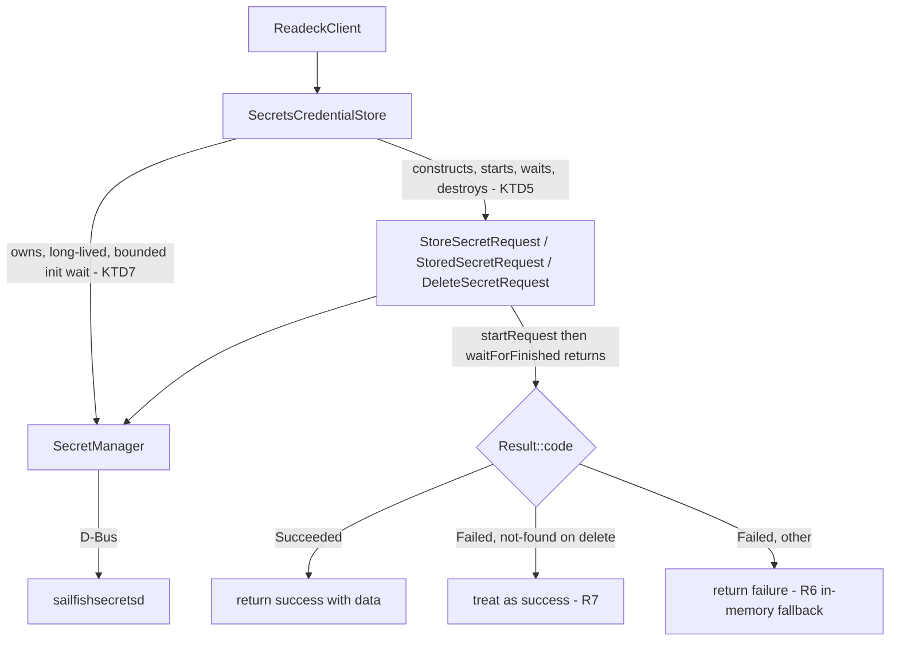

# Sailfish Secrets Credential Storage - Plan

## Goal Capsule

- **Objective:** Neither harbour-readeck's nor harbour-nextmarks' stored login credentials exist in plaintext on disk, and no existing logged-in user is signed out by the change that makes this true.
- **Means:** C++ against `libsailfishsecrets` (not the QML `Sailfish.Secrets` API), storing each app's username together with its token/password as one combined secret. harbour-readeck first; harbour-nextmarks follows once the pattern is proven.
- **Product authority:** Solo maintainer who builds and runs both apps — sole product authority, no separate stakeholder.
- **Execution:** code.
- **Open blockers:** Whether the verification spike (U1) actually succeeds end-to-end in the emulator. Planning confirmed the real C++ headers exist with usable constructors (`libsailfishsecrets-devel` now installed in the SDK build target, `Sailfish::Secrets::Secret`/`SecretManager`/request classes read directly) — the QML-side wall does not apply to C++ — but the spike has not yet been run.
- **Stop condition:** If the spike (U1) fails to reach `Result::Succeeded` on all three requests, stop and revisit this plan's approach rather than pushing the failure into the real migration.
- **Remaining work owner:** Planning/implementation continues for harbour-readeck now; harbour-nextmarks gets its own planning round afterward (see How This Work Fits Together).

## Product Contract

### Summary

Replace plaintext credential storage in both apps with Sailfish Secrets, accessed from C++. Each app stores its username and token/password together as one combined secret; everything else stays in QSettings. harbour-readeck is built first, verified, then the same pattern carries to harbour-nextmarks.

### Problem Frame

Both apps currently write login credentials straight into their QSettings config files as plaintext: harbour-readeck's API token, harbour-nextmarks' username and app password. This project already has a concrete incident behind "no personal data in public artifacts" — a real email address leaked into a published RPM's changelog earlier this project — and the same general rule now applies to a different kind of personal data: account credentials sitting in a plaintext file on the device. The goal isn't a specific attack scenario; it's removing plaintext credentials as a category, the same way the earlier incident led to removing personal identity data as a category.

A first attempt at this used the QML `Sailfish.Secrets` API and hit a real platform wall: `Secret` and `Secret::Identifier` cannot be constructed from QML at all in Sailfish OS's Qt 5.6 engine, confirmed by live testing in the SDK emulator (`Secrets.Secret { ... }` fails with "Secret objects cannot be constructed directly in QML"; assigning a plain JS object to a `secret:`/`identifier:` property fails with "Unable to assign QJSValue to Sailfish::Secrets::Secret"). This plan restarts the same goal against the C++ API instead.

### Requirements

**Verification and preconditions**

- R1. Before any `ReadeckClient` changes, a small isolated C++ test (following this project's established throwaway-diagnostic-hook pattern) stores, loads, and deletes one test secret via `libsailfishsecrets` in the SDK emulator, confirming the real C++ API works before the real migration starts.
- R2. The SDK build target has `libsailfishsecrets-devel` and its dependencies installed — confirmed via `sfdk tools target package-install SailfishOS-5.1.0.11-i486.default libsailfishsecrets-devel` and direct header reads; satisfied as of planning.

**Credential storage (harbour-readeck)**

- R3. harbour-readeck's username and token are stored together as a single combined secret (one JSON-encoded value under one stable identifier) via Sailfish Secrets, replacing the current plaintext `session/username` and `session/token` QSettings keys. `session/endpoint` and all non-credential preferences (e.g. `preferences/justifyArticleText`) stay in QSettings unchanged.
- R4. The combined-secret store/load/delete logic lives in one small, self-contained C++ helper, written so it can be reused in harbour-nextmarks with only field names and the identifier changed.

**Existing-user migration**

- R5. On first app launch after this ships, if a plaintext token still exists in the old QSettings location, it is migrated into Secrets once and then removed from QSettings. The user stays logged in without re-entering credentials.

**Failure handling**

- R6. If storing or loading the secret fails for any reason (daemon unreachable, request error), the current login still works for that run, held only in memory. Nothing is written back to plaintext QSettings as a fallback, and nothing persists past app exit.
- R7. Logging out deletes the stored secret. A delete that finds nothing already there (a session that was never persisted, or already migrated and cleared) is treated as a successful logout, not an error.

**harbour-nextmarks (follow-on)**

- R8. harbour-nextmarks' equivalent migration (username + `appPassword` as a combined secret) follows the same pattern once harbour-readeck's implementation is verified working. In addition to the two already-known `restoreSession`/`persistSession`/`logout` call sites, the browser-based Login Flow v2 callback (`src/nextcloudclient.cpp`, the JSON-response handler that currently sets `m_appPassword` directly) is a third place that must write through the new store.

### Key Decisions

- **C++ against `libsailfishsecrets`, not the QML `Sailfish.Secrets` API** (session-settled: user-directed — chosen over continuing with QML: QML cannot construct the `Secret`/`Identifier` value types in this Qt 5.6 engine at all, confirmed live). Governs R1, R3.
- **One combined secret per app, not two separate named secrets** (session-settled: user-directed — chosen over separate per-field secrets for username and token: fewer async round-trips and no partial-failure state between two parallel store/delete chains). Governs R3, R7.
- **Shared, reusable C++ helper shape, documented in the project's shared Sailfish skill once proven** (session-settled: user-directed — chosen over writing bespoke code twice: the same requirement applies to both apps, and the skill already captures this kind of cross-project pattern). Governs R4, R8.
- **A verification spike runs before real integration** (session-settled: user-directed — chosen over integrating directly into `ReadeckClient`: the QML path already failed this exact way once, so the unfamiliar C++ API gets de-risked in isolation first). Governs R1.
- **In-memory-only fallback on Secrets failure, never a plaintext fallback** (session-settled: user-directed — chosen over blocking login entirely or falling back to QSettings: keeps the app usable without undermining the goal of this work). Governs R6.
- **Automatic one-time migration of existing plaintext credentials** (session-settled: user-directed — chosen over requiring re-login after the update: existing installed users keep a working session across the update). Governs R5.
- **harbour-readeck first, harbour-nextmarks second** (session-settled: user-directed — chosen over doing both apps at once, or nextmarks first: readeck's token is only read/written at login/logout, while nextmarks' `buildRequest()` reads the credential synchronously on every HTTP request — the simpler case proves the pattern first). Governs R8.

### How This Work Fits Together

<!-- ce-section: work-relationships -->

This plan covers the Secrets-credential-storage pattern, with harbour-readeck as the concrete first implementation. The broader picture below is the current understanding, not a committed roadmap.

- harbour-nextmarks' equivalent migration (R8) — Depends on harbour-readeck's implementation being verified working; shares the same combined-secret helper shape; still to decide: how `buildRequest()`'s synchronous per-request credential read becomes compatible with Secrets' async access (see Scope Boundaries).
- MyBackup integration for each app's remaining non-credential settings — Can proceed independently of this plan; dropped from this plan's scope entirely (not merely deferred) because the user's actual goal — no plaintext credentials — is already met by Secrets, and the pattern for the remaining settings is already fully documented in the project's shared skill with no open questions.

### Scope Boundaries

- MyBackup integration is out of scope for this plan, for either app. It was previously considered alongside this work but was dropped once the actual goal (no plaintext credentials) was clarified as the real motivation, not "let users back up their account" — a secret stored in Sailfish Secrets isn't included in a MyBackup archive anyway, so the two goals pull in different directions for the credential fields specifically.
- harbour-nextmarks' `buildRequest()` redesign (today it reads `m_appPassword` synchronously on every HTTP request; Secrets access is async) is not designed in this plan. It's flagged as a known complication for harbour-nextmarks' own future planning round.
- No change to `session/endpoint` / `serverUrl`, or to any non-credential preference storage, in either app.

### Dependencies / Assumptions

- `libsailfishsecrets-devel` is installed into the SDK build target (R2 satisfied; confirmed via `sfdk tools target package-install` and direct header reads — see Sources / Research).
- U2's class design is grounded directly in the real headers (KTD1-KTD7); the one remaining unknown is whether the full request sequence actually completes successfully end-to-end, which is U1's entire purpose. A U1 failure sends this plan's approach back for revision rather than forward into U2-U5.
- `StandaloneDeviceLockSecret`'s protection depends on the device having a lock code configured at all; Sailfish OS allows disabling the device lock entirely, and neither the inspected headers nor this plan establish what protection remains in that configuration. Not resolved here — the maintainer's own device is locked, so U1-U4's exercises cover only that configuration; treat a device with no lock code as an open risk rather than an assumption this plan has verified.

### Outstanding Questions

**Deferred to Planning**
- harbour-nextmarks' async-caching design for `buildRequest()` (see Scope Boundaries) — resolved by this plan's `SecretsCredentialStore` (U2) existing as a reusable seam, but the call-site redesign itself is left to harbour-nextmarks' own future planning round.

### Key Flows

- F1. First launch after update, with a leftover plaintext credential
  - **Trigger:** App starts; QSettings still has a plaintext token/password from before this change shipped.
  - **Steps:** Read the plaintext value; store it as the combined secret; clear the plaintext QSettings keys; continue as already logged in.
  - **Covers:** R5
- F2. Fresh login
  - **Trigger:** User completes login (OAuth flow or token paste, depending on the app).
  - **Steps:** Hold credentials in memory; attempt to store the combined secret; on success, nothing further; on failure, keep the session in memory only for this run.
  - **Covers:** R3, R6
- F3. Launch with Secrets already in use
  - **Trigger:** No plaintext leftovers; migration already happened in an earlier run.
  - **Steps:** Load the combined secret; on success, resume the session; on failure or absence, show the login page.
  - **Covers:** R3
- F4. Logout
  - **Trigger:** User signs out.
  - **Steps:** Clear in-memory credentials; delete the stored secret; treat "not found" as success.
  - **Covers:** R7

### Acceptance Examples

- AE1. **Covers R5.** Given a user already logged in under the old plaintext version, when they open the app after updating, then they remain logged in and the plaintext token is gone from the config file afterward.
- AE2. **Covers R6.** Given the Secrets daemon is unreachable during login, when the user completes login, then the app still works for that session, and the config file never receives a plaintext token.
- AE3. **Covers R7.** Given a session that was never persisted because Secrets failed at login, when the user logs out, then no error is shown, even though no secret ever existed to delete.

### Sources / Research

- `src/readeckclient.cpp:274-292` (`persistSession`/`restoreSession`), `:576` (`finishLogin`), `:618` (`logout`) — current plaintext token storage.
- `src/nextcloudclient.cpp` (harbour-nextmarks) `restoreSession`/`persistSession`/`logout` (~lines 55-90), plus the Login Flow v2 JSON-response write site (~lines 238-253) — current plaintext password storage, including the third write site noted in R8.
- Live emulator testing (previous session): `Sailfish.Secrets` QML types cannot construct `Secret`/`Identifier` in this Qt 5.6 engine — confirmed via the exact runtime errors quoted in the Problem Frame.
- Confirmed package names via `pkcon search name secrets` against the Jolla repo, version 0.2.44: `libsailfishsecretsplugin`, `sailfishsecretsdaemon`, and `sailfishsecretsdaemon-cryptoplugins-default` are installed into the emulator runtime. `libsailfishsecrets-devel` is now installed into the SDK build target (`sfdk tools target package-install SailfishOS-5.1.0.11-i486.default libsailfishsecrets-devel`) — R2 is satisfied.
- Project's shared Sailfish skill notes the `Secrets` Sailjail permission token as available "since 4.5.0" — both apps already build against SailfishOS 5.1.0.11, so no version-compatibility concern exists here.
- Real C++ headers read directly from the now-installed devel package (`.../usr/include/Sailfish/Secrets/`): `secret.h` (`Secret`, `Secret::Identifier` — both have real public constructors, unlike the QML-exposed gadgets), `secretmanager.h` (`SecretManager`, `UserInteractionMode::PreventInteraction`), `storesecretrequest.h` (`StoreSecretRequest`, `SecretStorageType::StandaloneDeviceLockSecret`), `storedsecretrequest.h` (`StoredSecretRequest`), `deletesecretrequest.h` (`DeleteSecretRequest`), `request.h` (`Request::Status` Inactive/Active/Finished, `statusChanged` signal). `pkgconfig(sailfishsecrets)` provides `-lsailfishsecrets`, requires `Qt5Core`/`Qt5DBus`.
- A separate product idea explored and declined in this planning round (configurable session timeout, biometric/fingerprint re-authentication): the device only supports single-factor PIN/code device-lock (`jolla-devicelock-plugin-encsfa`), no fingerprint/biometric plugin exists anywhere in the installed package set — confirmed via `pkcon search name biometric`/`fingerprint` (no results) and `rpm -qa | grep -i fingerprint` (no results). Not part of this plan's scope; recorded here so the finding isn't rediscovered later.

## Planning Contract

**Product Contract preservation:** unchanged. Two additional product ideas (configurable session timeout; biometric/fingerprint re-authentication) were raised and explored during planning and explicitly declined by the user — no Requirements, Key Decisions, Flows, or Acceptance Examples were added or altered as a result; see the Sources / Research note above.

### Key Technical Decisions

- KTD1. **`StandaloneDeviceLockSecret` storage type, not a collection.** Chosen over `SecretStorageType::CollectionSecret`: a collection needs its own `CreateCollectionRequest` setup step first, and this plan ever stores exactly one secret per app — standalone skips that extra async step and extra moving part entirely. Confirmed against the real enum in `storesecretrequest.h`. Governs R3.
- KTD2. **`SecretManager::PreventInteraction` on every request.** Chosen over `SystemInteraction`/`ApplicationInteraction`: this plan's confirmed scope has no re-authentication step at all (the user explicitly declined one) and the credential needs no user-facing unlock prompt beyond the device's own lock state — `PreventInteraction` also keeps a daemon failure resolving to a clean `Result::Failed` instead of a stuck prompt, which R6's in-memory fallback depends on. Governs R3, R6.
- KTD3. **One long-lived `SecretManager` instance per `SecretsCredentialStore`, not a per-call local.** Chosen directly from this exact codebase's own confirmed crash history: a short-lived `QNetworkAccessManager` local variable caused a real SIGSEGV here because its `QNetworkReply` was destroyed before a deferred `deleteLater()` could run; `SecretManager`'s D-Bus-backed async request lifecycle carries the same shape of risk. Governs R4.
- KTD4. **Secret identifier built with an empty `collectionName`** (`Secret::Identifier(name, QString(), QString())`), matching `secret.h`'s real constructor signature and what `Secret::Identifier::identifiesStandaloneSecret()` checks for when paired with `StandaloneDeviceLockSecret`. Governs R3, R4.
- KTD5. **`SecretsCredentialStore`'s store/load/remove calls are synchronous (`startRequest()` immediately followed by `waitForFinished()`), not an async signal-chain.** Chosen over async signals: `ReadeckClient`'s startup already depends on `restoreSession()` resolving `isLoggedIn` synchronously, since `main.cpp` evaluates QML's `initialPage` ternary before `app->exec()` starts the event loop an async D-Bus reply would need — an async `load()` would leave `isLoggedIn` false at that exact moment on every ordinary launch, not just migration, breaking R5/AE1. A synchronous call also removes the dangling-object risk a stack-allocated, fire-and-forget `Request` would otherwise carry — the same shape of bug this codebase already fixed once for `QNetworkAccessManager`/`QNetworkReply` (KTD3) — since each `Request` is constructed, started, waited on, and destroyed within one function call, with nothing left pending when that function returns. `Request::waitForFinished()` is a real method on the base class (confirmed in `request.h`); U1's spike verifies it actually blocks and returns the completed result rather than assuming its behavior. Governs R3, R6, R7.
- KTD6. **`StoreSecretRequest::deviceLockUnlockSemantic` explicitly set to `DeviceLockKeepUnlocked`.** Chosen over `DeviceLockVerifyLock`/`DeviceLockRelock`: the plan's settled behavior — logged in for as long as the app is running, no re-authentication step — matches only `DeviceLockKeepUnlocked`; either stricter semantic would turn an ordinary device lock/unlock cycle into an unexpected `Result::Failed` under `PreventInteraction` (KTD2), routing the session into R6's fallback far more often than intended. Governs R3, R6.
- KTD7. **Constructing `SecretManager` itself gets a bounded timeout, owned once inside `SecretsCredentialStore`, not each caller.** Confirmed in U1's spike, not merely anticipated: `systemctl --user stop sailfish-secretsd.service` alone does **not** test an unreachable daemon, because `sailfishsecretsd` is D-Bus-activatable and respawns transparently on the next request; only disabling the binary outright (`chmod 000` on the daemon executable, reverted immediately after) produced a genuinely unreachable daemon. Under that condition, `SecretManager`'s constructor itself hung for the full 20-second test timeout with zero log output — not a specific request, construction itself, before `isInitialized()` can even be read. `SecretsCredentialStore` must wrap construction in its own bounded wait so every one of U3's call sites gets the same timeout behavior for free, rather than each caller coordinating it. Governs R6.
- KTD8. **`StoreSecretRequest::encryptionPluginName` and the `Secret::Identifier`'s `storagePluginName` are set explicitly to `org.sailfishos.secrets.plugin.encryption.openssl` and `org.sailfishos.secrets.plugin.storage.sqlite`.** Confirmed necessary in U1's spike: leaving both at their class defaults (empty strings) made every request fail with `SecretManagerNotInitializedError` and the D-Bus-level error "Unexpected reply signature: got \"\", expected \"(iis)\"", even though `isInitialized()` correctly reported `true` — the daemon has no implicit default plugin to fall back to. Confirmed against the daemon's own `secrets-tool --list-plugins` output on the emulator, and verified end-to-end via `secrets-tool --store-standalone-secret`/`--get-standalone-secret` with these exact plugin names before changing the C++ code. Resolves the residual risk this plan's planning round flagged (`encryptionPluginName`/`authenticationPluginName` defaults unverified) for the encryption side; no `authenticationPluginName` is needed for a device-lock-protected standalone secret (confirmed via the same CLI tool, whose `--devicelock` flag needs no authentication plugin argument). Governs R3, R4.

### High-Level Technical Design

The request lifecycle is the same shape for store, load, and delete — one `Request` subclass per operation, constructed and started, then `waitForFinished()` blocks until `Request::Status` reaches `Finished` (KTD5), then the caller branches on `Result::code()`.

### Assumptions

- The exact JSON-serialization approach (`QJsonDocument` round-tripped through `Secret::setData`/`data()` as a `QByteArray`) is assumed compatible based on `secret.h`'s `QByteArray data` property — U1's spike exercised only a plain string payload, not yet a JSON-encoded `QVariantMap`; U2 exercises this directly.
- `libsailfishsecrets` (the runtime library, distinct from `-devel`) is assumed present on real devices as a base-OS package rather than something Harbour apps must bundle — consistent with it already being installed on the emulator without being explicitly requested; U5 adds an explicit RPM `Requires:` regardless (and `sfdk build`'s automatic dependency detection already added `libsailfishsecrets.so.0` to the built RPM's `Requires:` once the CMake/pkg-config linking was in place), so the assumption is not load-bearing if wrong.
- `Request::waitForFinished()` is confirmed, not merely assumed, to block until the real D-Bus reply arrives: U1's spike observed `Result::Succeeded` and the correct round-tripped data immediately after each `waitForFinished()` call, with no manual event-loop code anywhere in the spike (KTD5).

## Implementation Units

### U1. Verification spike: C++ store/load/delete round-trip

- **Goal:** Prove the real `libsailfishsecrets` C++ API works end-to-end (store, load, delete one test secret) in the SDK emulator before any `ReadeckClient` code changes, following this project's established throwaway-diagnostic-hook pattern.
- **Requirements:** R1, R2. KTD1, KTD2, KTD4, KTD5, KTD6, KTD7, KTD8.
- **Dependencies:** none.
- **Files:** a temporary diagnostic hook in `src/main.cpp` (env-var-gated: `READECK_SECRETS_SPIKE=1` ran the spike and exited instead of starting the app, mirroring this project's prior PDF-crash-investigation hook) — added, exercised, and fully removed again; `rpm/harbour-readeck.spec` (`BuildRequires: pkgconfig(sailfishsecrets)` — kept); `CMakeLists.txt` (`pkg_search_module(SAILFISHSECRETS REQUIRED sailfishsecrets)` plus its include dirs and `LDFLAGS` added to the target — kept).
- **Approach (as executed):**
  1. Added the `BuildRequires`/CMake linking for `pkgconfig(sailfishsecrets)`; `sfdk build`'s automatic dependency detection picked up `libsailfishsecrets.so.0` into the RPM's `Requires:` on its own.
  2. Constructed a `Sailfish::Secrets::SecretManager`; `isInitialized()` read `true` immediately, so no explicit wait was needed in the happy-path spike — but see step 6 below, which found a real initialization hang under a different condition.
  3. First attempt left `Secret::Identifier`'s `storagePluginName` and `StoreSecretRequest::encryptionPluginName` at their class defaults (empty strings). Every request failed with `SecretManagerNotInitializedError` / D-Bus error "Unexpected reply signature: got \"\", expected \"(iis)\"", despite `isInitialized()` being `true`.
  4. Used the daemon's own `secrets-tool --list-plugins` on the emulator to find the real registered plugin names, then verified `secrets-tool --store-standalone-secret --devicelock --keep-unlocked org.sailfishos.secrets.plugin.storage.sqlite org.sailfishos.secrets.plugin.encryption.openssl` and the matching `--get-standalone-secret` worked outside any of this project's own code — confirming the daemon/plugins were healthy and the bug was in the spike's own request configuration, not the platform.
  5. Set the identifier's `storagePluginName` and the request's `encryptionPluginName` to those exact plugin names (KTD8) and re-ran: `StoreSecretRequest` → `StoredSecretRequest` → `DeleteSecretRequest`, each via `startRequest()` then immediately `waitForFinished()` (KTD5), all three reached `Finished` with `Result::Succeeded`, and the loaded data matched the stored bytes exactly.
  6. Tested the daemon-unreachable path: `systemctl --user stop sailfish-secretsd.service` alone did **not** reproduce it — the daemon respawned via D-Bus activation on the next request. Only `chmod 000` on `/usr/bin/sailfishsecretsd` (reverted immediately after the test) genuinely blocked it; under that condition, constructing `SecretManager` itself hung for the full 20-second test timeout with zero log output, confirming KTD7's bounded-timeout wrapper must cover construction, not just individual requests.
  7. Removed the diagnostic hook from `main.cpp`; confirmed `git status` shows no diff against the pre-spike baseline for that file.
- **Technical design:** the request sequencing is directional pseudo-code, not a literal method body — `request.setManager(...); request.startRequest(); request.waitForFinished();` then branch on `request.result().code()`, all inside one function, no signal connections needed.
- **Test scenarios:**
  - Happy path: store → load → delete round-trip succeeded; loaded `Secret::data()` matched the stored bytes exactly; each step's `waitForFinished()` call returned only once `status() == Request::Finished`. **Result: confirmed.**
  - Error path: a missing `encryptionPluginName`/`storagePluginName` reproduced a clean `Result::Failed` (`SecretManagerNotInitializedError`) rather than a crash — confirms the earlier QML-side failure mode is avoidable, not just hidden, in C++, though the actual cause (missing plugin names) was not the one originally hypothesized. **Result: confirmed, root cause identified and fixed (KTD8).**
  - Error path (KTD7): a genuinely unreachable daemon (binary disabled, not just the service stopped) hung `SecretManager`'s constructor indefinitely rather than failing cleanly. **Result: confirmed as a real gap; U2 must implement the bounded-timeout wrapper KTD7 specifies — U1 only proved the gap exists, it does not close it.**
- **Verification:** journal output from the diagnostic hook showed `Succeeded` for all three requests after the plugin-name fix; the daemon-unreachable case was exercised against a genuinely disabled daemon binary and confirmed to hang rather than fail cleanly; the diagnostic hook was fully removed afterward (`git status` clean for `src/main.cpp`).

### U2. Shared `SecretsCredentialStore` C++ helper

- **Goal:** One small, reusable class wrapping store/load/delete of a single combined-JSON secret, usable by `ReadeckClient` now and `NextcloudClient` later.
- **Requirements:** R3, R4. KTD1, KTD2, KTD3, KTD4, KTD5, KTD6, KTD7, KTD8.
- **Dependencies:** U1.
- **Files:** `src/secretscredentialstore.h`, `src/secretscredentialstore.cpp` (new); `CMakeLists.txt` (add the two new sources to the target); a temporary diagnostic hook for this unit's own verification (same shape as U1's, reused rather than duplicated where possible) — removed again before U3 starts.
- **Approach:**
  1. Class owns one `Sailfish::Secrets::SecretManager` member with a lifetime spanning the owning object (per KTD3), constructed with the app's stable secret name (e.g. `QStringLiteral("harbour-readeck/session")`) passed into the helper's constructor so `NextcloudClient` can later instantiate it with its own name.
  2. In the constructor, wait once for `SecretManager::isInitialized()` with the bounded timeout KTD7 specifies; if it times out, every subsequent call returns the same "failed" outcome store/load/remove use for a genuine daemon failure, without ever calling `startRequest()`.
  3. `store(const QVariantMap &fields)` returns an outcome enum (`Succeeded`/`Failed`) synchronously: serialize `fields` to compact JSON via `QJsonDocument`, build a `Secret` (KTD4's identifier shape, with `storagePluginName` set per KTD8) with `setData()`, construct a `StoreSecretRequest` with `encryptionPluginName` set per KTD8 and `deviceLockUnlockSemantic` per KTD6, call `startRequest()` then `waitForFinished()` (KTD5), and return based on `result().code()` before the function returns — no signal connections, no object outliving this call.
  4. `load(QVariantMap *outFields)` returns a three-way outcome (`Succeeded`/`NotFound`/`Failed`) synchronously, the same way: construct a `StoredSecretRequest`, `startRequest()` + `waitForFinished()`, and on `Succeeded` parse the JSON back into `*outFields`; a "no such secret" result maps to `NotFound`, anything else to `Failed`.
  5. `remove()` returns `Succeeded`/`Failed` synchronously the same way; both an actual `Result::Succeeded` and the "secret does not exist" error map to `Succeeded` (R7), so a caller never has to special-case "never existed" itself.
- **Technical design:** each public method follows the same synchronous shape — `SomeRequest request; request.setManager(&m_manager); /* set properties */; request.startRequest(); request.waitForFinished(); return mapResult(request.result());` — directional, not a literal method body. `ReadeckClient` (U3) and a future `NextcloudClient` integration call these methods directly and act on the returned outcome in the same line, with no callback to wire up.
- **Test scenarios:**
  - Happy path: `store({username, token})` then `load()` returns the same map, both calls returning before the next line of caller code runs.
  - Edge case: `load()` when nothing was ever stored returns `NotFound`, distinct from `Failed`.
  - Error path: daemon unreachable during `store()` returns `Failed`, the outcome `ReadeckClient` (U3) uses for R6's in-memory-only fallback.
  - Error path (KTD7): construct `SecretsCredentialStore` while the daemon binary is genuinely disabled (`chmod 000 /usr/bin/sailfishsecretsd`, reverted after — U1 confirmed `systemctl --user stop` alone self-heals via D-Bus activation and does not test this path); confirm the constructor's bounded wait times out and every subsequent call returns `Failed` immediately, without hanging or ever calling `startRequest()`.
  - Covers AE3: `remove()` on an identifier that was never stored still returns `Succeeded`, not `Failed`.
- **Verification:** exercised through a diagnostic hook calling the new class's `store`/`load`/`remove` directly (not the raw API), confirming all three named outcomes (`Succeeded`/`NotFound`/`Failed`) are each reachable, that every call returns synchronously, and that the genuinely-disabled-daemon case times out rather than hanging; the diagnostic hook is fully removed again before U3 starts (`git status` clean).

### U3. Wire `ReadeckClient` to `SecretsCredentialStore`

- **Goal:** Replace plaintext `session/username`/`session/token` QSettings read/write with calls to the new helper.
- **Requirements:** R3, R6, R7. KTD5. Covers F2, F3, F4; AE2, AE3.
- **Dependencies:** U2.
- **Files:** `src/readeckclient.h`, `src/readeckclient.cpp`.
- **Approach:**
  1. `restoreSession()`: stop reading `username`/`token` from `QSettings`; keep reading `endpoint`. Call `SecretsCredentialStore::load()` (synchronous, KTD5) directly in the constructor, exactly where the old QSettings read used to be; on `Succeeded`, populate `m_username`/`m_token` before the constructor returns, so `isLoggedIn` is already correct by the time `main.cpp`'s `view->setSource(...)` evaluates QML's `initialPage` — unchanged from today's behavior. On `NotFound` or `Failed`, leave the client logged out (F3 falls through to the login page).
  2. `finishLogin()`: after setting `m_token`/`m_username` in memory (unchanged), call `SecretsCredentialStore::store(...)`; on `Failed`, log a warning and continue — the session stays usable in memory for this run only (R6); on `Succeeded`, nothing further is needed since the in-memory fields are already set.
  3. `persistSession()`: remove the `token`/`username` `QSettings::setValue` calls entirely; keep persisting `endpoint`.
  4. `logout()`: call `SecretsCredentialStore::remove()` *before* clearing in-memory state and emitting `isLoggedInChanged()` (the call is synchronous, so the real outcome is known first). `Succeeded` (including the not-found case, R7) proceeds to clear memory and complete logout normally. On `Failed`, still clear memory and complete logout from the user's perspective (today's existing unconditional behavior is unchanged), but set a "pending secret delete" flag in `QSettings` first — U4 checks this flag on the next launch and retries the delete before trusting any `restoreSession()` load, so a secret that failed to delete can never silently resurrect a session the user explicitly ended.
- **Test scenarios:**
  - Happy path: fresh login stores the combined secret; killing and relaunching the app restores the session from Secrets with no QSettings involvement, with `isLoggedIn` already correct before QML's `initialPage` is evaluated.
  - Covers AE2: Secrets daemon unreachable during login — session still usable for that run; `harbour-readeck.conf`'s `session` group never receives `username`/`token` keys.
  - Covers AE3: logout after a session that was never persisted (the AE2 scenario) completes without error.
  - Edge case: logging out twice in a row — the second logout has nothing to delete and behaves the same as AE3.
  - Edge case: logout while the daemon is unreachable — the app shows the user as logged out immediately, a pending-delete flag is set, and the stale secret is not loaded back in on the very next launch.
- **Verification:** manual login/logout/relaunch cycle in the emulator, plus inspecting `~/.config/harbour-readeck/harbour-readeck.conf` directly to confirm no `username`/`token` keys appear under any condition exercised above, plus one logout exercised with the daemon binary genuinely disabled (not just `systemctl --user stop`, which self-heals — see U1) to confirm the pending-delete flag path.

### U4. Existing-user migration on launch

- **Goal:** Users already running the currently-shipped plaintext version keep their session across the update; a logout whose secret-delete failed (U3) never silently resurrects on the next launch.
- **Requirements:** R5, R7. Covers F1, AE1.
- **Dependencies:** U2, U3.
- **Files:** `src/readeckclient.cpp` (constructor / `restoreSession()`).
- **Approach:**
  1. On construction, before the ordinary U3 load path, first check U3's "pending secret delete" flag; if set, call `SecretsCredentialStore::remove()` and only clear the flag on `Succeeded` — this must happen before any load, so a secret that a prior logout failed to delete never gets loaded back into a session.
  2. Then check whether the old plaintext `session/token` `QSettings` key still holds a non-empty value (the exact leftover from every version up to and including the one currently shipped).
  3. If present: read it (and `session/username`), call `SecretsCredentialStore::store(...)` once; on success, remove both plaintext keys via `QSettings::remove(...)`. If the one-time store fails, leave the plaintext values in place for this run and let the same check retry on the next launch — never lose the session mid-migration.
  4. If absent: proceed with the ordinary U3 load path unchanged.
- **Test scenarios:**
  - Covers AE1: a `harbour-readeck.conf` seeded with a leftover plaintext token, after one launch, has the token in Secrets and the plaintext key gone, with the user still logged in.
  - Covers R7: a `harbour-readeck.conf` seeded with the pending-delete flag set (simulating U3's daemon-unreachable logout) and the secret still present in Secrets — after one launch, the secret is deleted, the flag is cleared, and the app shows the login page, not a resumed session.
  - Edge case: migration attempted while the Secrets daemon is unreachable — the plaintext key is left in place (not deleted), and migration retries on the next launch instead of losing the credential.
  - Edge case: a fresh install with no leftover plaintext key skips migration and behaves exactly like U3's ordinary load path.
- **Verification:** seed a test config file with a plaintext token (mirroring a real pre-update install), launch, confirm continued login and that the plaintext key is gone afterward.

### U5. RPM packaging and shared-skill documentation

- **Goal:** The build/package definition reflects the new runtime dependency, and the proven C++ pattern is written into the shared Sailfish skill for reuse on harbour-nextmarks.
- **Requirements:** supports R3/R4; documents the pattern referenced by R8.
- **Dependencies:** U1, U2, U3, U4 all verified working.
- **Files:** `rpm/harbour-readeck.spec` (`Requires: libsailfishsecrets` alongside the existing `BuildRequires: pkgconfig(sailfishsecrets)` added in U1); `claude-sailfish-skill/sailfishos-app/references/guidelines.md` and `templates.md` (outside this repo) — new pattern/pitfall entries for the QML-dead-end-then-C++-works story, pushed to the skill's own GitHub repo per this project's established practice.
- **Approach:** mechanical — add the real `Requires:` line confirmed in U1's research; write up the finding (QML cannot construct `Secret`/`Identifier`; the real C++ constructors do exist and work) as a new skill pitfall, matching the shape of this project's existing Secrets-related skill entries.
- **Test scenarios:** Test expectation: none -- packaging metadata and documentation, not application behavior.
- **Verification:** `sfdk build` succeeds with the new `BuildRequires` resolved; `rpm -qp --requires` on the built RPM lists the runtime Secrets library.

## Verification Contract

| Scope | Command / check | Applies to |
|---|---|---|
| Build | `sfdk build` (i486 emulator target) | U1-U5 |
| Package metadata | `sfdk build-shell rpm -qp --requires RPMS/harbour-readeck-*.rpm` includes the Secrets runtime library | U5 |
| Config-file inspection | Read `~/.config/harbour-readeck/harbour-readeck.conf` directly after login/logout/relaunch cycles; confirm no `username`/`token` keys ever appear under `[session]` | U3, U4 |
| Manual integration exercise | Login → relaunch → logout → relaunch, repeated with the daemon binary genuinely disabled (`chmod 000 /usr/bin/sailfishsecretsd`, reverted after — plain `systemctl --user stop` self-heals via D-Bus activation and does not test this, per U1) to exercise R6's failure path | U1-U4 |
| Migration exercise | Seed `harbour-readeck.conf` with a plaintext `session/token` value (simulating a pre-update install), launch once, confirm migration per U4 | U4 |
| Daemon-unreachable exercises | Repeat construction/login/logout with the daemon binary genuinely disabled; confirm the bounded init wait (KTD7) times out rather than hanging, and a failed logout delete sets and later clears the pending-delete flag (U3, U4) | U1-U4 |

No existing automated test suite covers C++ behavior in this project (confirmed: no test harness found in `src/` or `CMakeLists.txt` during planning) — verification here is manual/integration-level, matching the plan-time scope decision confirmed with the user.

## Definition of Done

- All five units (U1-U5) complete and individually verified per their own Verification field.
- `~/.config/harbour-readeck/harbour-readeck.conf` contains no `username` or `token` key under any exercised condition (fresh login, relaunch, daemon-unreachable login, logout, migration from a seeded plaintext config).
- The verification spike's diagnostic hook and any other temporary debug code added during U1/U2 are fully removed; `git status` is clean before the final commit.
- `sfdk build` succeeds and the built RPM's changelog (`rpm/harbour-readeck.changes`) carries a new entry using the project's placeholder author identity, per this project's established privacy practice.
- The shared Sailfish skill (outside this repo) has been updated with the new C++ Secrets pattern and pushed, per this project's established skill-sync practice.
- harbour-nextmarks' own migration (R8) has not been started as part of this plan — confirmed still correctly scoped to a future planning round.
